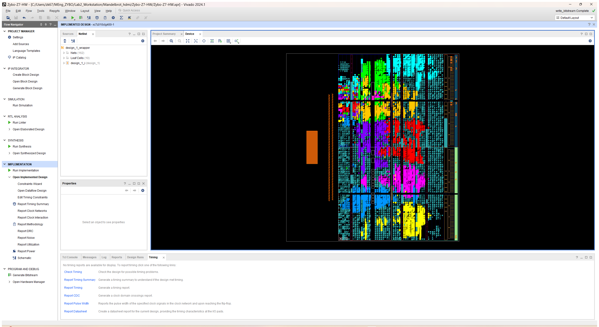

# Lab 2 optimization log + plan (DSPs, chip view, code changes)

Running record of every optimization step: what changed in the code, what it cost in DSPs and other resources, and what it bought in render time. Fill in one section per step.

## Plan (from 2026-11-09)
1. **Track DSPs at every step**: they're the resource that limits multiplication, a core idea of the lab. Record DSPs used / 80 and multiplies per iterator for every build (table below).
2. **DE1 vs Zybo DSP side-by-side** (done below): how many multiplies each board can do at each width.
3. **Chip-viewer pictures** for every step: Vivado → *Open Implemented Design* → *Device* tab → highlight the Mandelbrot IP (and the solvers) → save a screenshot into `Lab2_Workstation/figures/chip_<step>.png`. Script: `Mandelbrot_hdmi/scripts/chip_view.tcl` (opens the GUI, colours the blocks; take the screenshot, then close Vivado).
4. **Exact code changes per optimization** (below, as diffs), so the next step can be planned from what changed and what it cost.
5. Shared cardioid + period-2-bulb test implemented on `shared-inside-set` (step 4 below); board timing is now measured; record each configuration before another optimization.

## DSPs: how many multiplications fit
| | DE1-SoC (Cyclone V 5CSEMA5) | Zybo Z7-10 (Zynq xc7z010) |
|---|---|---|
| DSP blocks | **87** | **80** (DSP48E1) |
| Native multiplier per block | 27×27 (or 2× 18×18, or 3× 9×9) | 25×18 |
| 27×27 multiplies possible | **87** (1 block each) | **26** (measured: 3 DSPs each) |
| 18×18 multiplies possible | 174 | 80 |
| Multiplies per iterator (zr², zi², zr·zi) | 3 | 3 |
| DSPs per iterator at 27-bit (Q4.23) | 3 | **9** (measured) |
| Max iterators at 27-bit | 29 (report built 24 = 72 DSPs) | **8** (built: 72/80 DSPs) |
| Max iterators at ≤18-bit numbers | 58 (by DSPs) | 26 (by DSPs; LUTs then limit to ~12–15) |

So the DE1 has slightly more DSP blocks (87 vs 80), but the real difference is that **each Cyclone V block does a full 27×27 multiply, while a Zynq DSP48E1 only does 25×18**. A 27-bit Mandelbrot iterator costs 3× more DSPs on the Zybo.

## Step-by-step record
| Step | Branch / commit | Iterators | DSPs | LUTs | WNS @100 MHz | Full set (ms) |
|---|---|---|---|---|---|---|
| v1 | `main` | 4 | 36 (45 %) | 11,623 (66 %) | +0.255 | 792.2 |
| HDMI input removed | `strip-hdmi-in` `4ab3558` | 4 | 36 (45 %) | 8,187 (46.5 %) | +0.223 | 792.2 |
| 8 iterators, original engine | `nsolv-8` `5b7b0e5` | 8 | 72 (90 %) | 11,496 (65 %) | **−0.731** | 399.9 (out of spec) |
| 8 iterators, pipelined engine | `engine-pipeline` `e226f79` | 8 | 72 (90 %) | 11,267 (64 %) | +0.147 | **399.4** |
| Shared inside-set classifier | `shared-inside-set` `1828dd9` | 8 | 76 (95 %) | 11,707 (66.52 %) | +0.236 | **93.442 (board)** |

### Step 1: remove HDMI input (no RTL change)
- Block design only: `Mandelbrot_hdmi/scripts/strip_hdmi_in.tcl` deletes `dvi2rgb`, `v_vid_in_axi4s`, `v_tc_in`, `axis_subset_converter_in`, the RX reset, `axi_gpio_video`; turns off the VDMA write channel and FCLK2; moves the IP to `hp0/S01` (FCLK0). Constraints: HDMI RX pins commented out in `Zybo-Z7-Master.xdc`.
- Also: driver `Makefile` typo fixed in the IP (`LIBSOURCES=($wildcard *.c)` → `$(wildcard *.c)`).
- Effect: −3,436 LUTs, −6,063 FFs, −7 BRAM, −1 MMCM, **0 DSPs**, same speed.

### Step 2: 4 → 8 iterators (no RTL change)
- One IP parameter: `NSOLV` 4 → 8 (`scripts/set_nsolv.tcl -tclargs 8`). DSPs 36 → 72.
- Effect: 2× speed, but timing failed: the **result arbiter** (pick 1 of 8 + 8:1 data mux in one clock) and the **dispenser → solver entry** ("first free of 8" + inject + adder in one clock).

### Step 3: pipeline the arbiter and the solver entry (RTL change)
- `mandel_engine.v`: the round-robin arbiter now registers a one-hot `grant` (masked priority: requests above the last winner first), and the data moves next clock through a one-hot AND-OR mux.
- `mandel_solver.v`: a one-pixel input buffer (`ib_*`); `in_ready = ~ib_v` is a flip-flop, so the dispenser never waits on the ring combinationally.
- Verified: `tb_engine_compare.v` (old vs new engine, 3 frames, random AXI stalls), identical bytes, +0.35 % cycles. Same DSPs (72).
- Exact diff (`strip-hdmi-in` → `engine-pipeline`):

```diff
diff --git a/Lab2_Workstation/Mandelbrot_hdmi/Zybo-Z7-HW/ip_repo/mandelbrot_driver_1_0/src/mandel_engine.v b/Lab2_Workstation/Mandelbrot_hdmi/Zybo-Z7-HW/ip_repo/mandelbrot_driver_1_0/src/mandel_engine.v
index 20be381..5406a3b 100644
--- a/Lab2_Workstation/Mandelbrot_hdmi/Zybo-Z7-HW/ip_repo/mandelbrot_driver_1_0/src/mandel_engine.v
+++ b/Lab2_Workstation/Mandelbrot_hdmi/Zybo-Z7-HW/ip_repo/mandelbrot_driver_1_0/src/mandel_engine.v
@@ -165,41 +165,53 @@ module mandel_engine #(
     endgenerate
 
     // ===================================================== result arbiter
-    // Round-robin: one finished pixel per clock goes to the row buffer; the others circle once more.
-    reg       [7:0] rr_ptr;
-    reg             g_found;
-    reg       [7:0] g_idx;
-    integer         k, idx;
-    always @(*) begin
-        g_found = 1'b0;
-        g_idx   = 8'd0;
-        for (k = 0; k < NSOLV; k = k + 1) begin
-            idx = rr_ptr + k;
-            if (idx >= NSOLV) idx = idx - NSOLV;
-            if (!g_found && s_out_valid[idx]) begin
-                g_found = 1'b1;
-                g_idx   = idx;
-            end
+    // Two stages so the pick and the data move are in different clocks:
+    //   1. pick: a registered one-hot grant, round-robin (requests above the last winner first)
+    //   2. move: the granted solver's output is taken through a one-hot AND-OR mux
+    // A solver holds its result until it sees out_ready, so the result is still there when the
+    // registered grant arrives. The solver granted this clock is masked out of the next pick.
+    reg  [NSOLV-1:0] grant;                   // stage 1 result, one-hot or zero
+    reg  [NSOLV-1:0] last;                    // one-hot of the most recent winner
+    wire [NSOLV-1:0] req     = s_out_valid & ~grant;
+    wire [NSOLV-1:0] above   = ~((last << 1) - 1'b1) & ~last;   // positions strictly above the last winner
+    wire [NSOLV-1:0] req_hi  = req & above;
+    wire [NSOLV-1:0] pick_hi = req_hi & (~req_hi + 1'b1);       // lowest set bit
+    wire [NSOLV-1:0] pick_lo = req    & (~req    + 1'b1);
+    wire [NSOLV-1:0] pick    = (|req_hi) ? pick_hi : pick_lo;
+
+    always @(posedge clk) begin
+        if (rst) begin
+            grant <= {NSOLV{1'b0}};
+            last  <= {{(NSOLV-1){1'b0}}, 1'b1} << (NSOLV-1);     // so solver 0 is first
+        end else begin
+            grant <= pick;
+            if (|pick) last <= pick;
         end
     end
-    assign s_out_ready = g_found ? ({{(NSOLV-1){1'b0}}, 1'b1} << g_idx) : {NSOLV{1'b0}};
+    assign s_out_ready = grant;
 
     reg            w1_v;                      // granted result, registered
     reg   [XW-1:0] w1_x;
     reg   [YW-1:0] w1_y;
     reg   [IW-1:0] w1_cnt;
-    always @(posedge clk) begin
-        if (rst) begin
-            rr_ptr <= 8'd0;
-            w1_v   <= 1'b0;
-        end else begin
-            w1_v <= g_found;
-            if (g_found)
-                rr_ptr <= (g_idx == NSOLV-1) ? 8'd0 : g_idx + 1'b1;
+    reg   [XW-1:0] mx_x;
+    reg   [YW-1:0] mx_y;
+    reg   [IW-1:0] mx_cnt;
+    integer        k;
+    always @(*) begin                         // one-hot AND-OR mux
+        mx_x = {XW{1'b0}}; mx_y = {YW{1'b0}}; mx_cnt = {IW{1'b0}};
+        for (k = 0; k < NSOLV; k = k + 1) begin
+            mx_x   = mx_x   | (s_out_x[k*XW +: XW]   & {XW{grant[k]}});
+            mx_y   = mx_y   | (s_out_y[k*YW +: YW]   & {YW{grant[k]}});
+            mx_cnt = mx_cnt | (s_out_cnt[k*IW +: IW] & {IW{grant[k]}});
         end
-        w1_x   <= s_out_x[g_idx*XW +: XW];
-        w1_y   <= s_out_y[g_idx*YW +: YW];
-        w1_cnt <= s_out_cnt[g_idx*IW +: IW];
+    end
+    always @(posedge clk) begin
+        if (rst) w1_v <= 1'b0;
+        else     w1_v <= |grant;
+        w1_x   <= mx_x;
+        w1_y   <= mx_y;
+        w1_cnt <= mx_cnt;
     end
 
     // ======================================================== colour (lab palette)
diff --git a/Lab2_Workstation/Mandelbrot_hdmi/Zybo-Z7-HW/ip_repo/mandelbrot_driver_1_0/src/mandel_solver.v b/Lab2_Workstation/Mandelbrot_hdmi/Zybo-Z7-HW/ip_repo/mandelbrot_driver_1_0/src/mandel_solver.v
index 26ecc59..3485426 100644
--- a/Lab2_Workstation/Mandelbrot_hdmi/Zybo-Z7-HW/ip_repo/mandelbrot_driver_1_0/src/mandel_solver.v
+++ b/Lab2_Workstation/Mandelbrot_hdmi/Zybo-Z7-HW/ip_repo/mandelbrot_driver_1_0/src/mandel_solver.v
@@ -79,11 +79,30 @@ module mandel_solver #(
     reg        [YW-1:0] o_y;
     reg        [IW-1:0] o_cnt;
 
+    // One-pixel input buffer: in_ready is a flip-flop, so the dispenser's "first free solver"
+    // scan never runs through this ring's recirculate logic in the same clock.
+    reg                 ib_v;
+    reg        [XW-1:0] ib_x;
+    reg        [YW-1:0] ib_y;
+    reg signed [W-1:0]  ib_cr, ib_ci;
+
     wire emit   = h_v & h_f & ~o_v;        // finished pixel moves to the output buffer
     wire recirc = h_v & ~emit;             // HEAD stays in the ring
-    wire inject = ~recirc & in_valid;      // new pixel enters the free slot
+    wire inject = ~recirc & ib_v;          // buffered pixel enters the free slot
+
+    assign in_ready  = ~ib_v;
 
-    assign in_ready  = ~recirc;
+    always @(posedge clk) begin
+        if (rst)                      ib_v <= 1'b0;
+        else if (in_valid & ~ib_v)    ib_v <= 1'b1;
+        else if (inject)              ib_v <= 1'b0;
+        if (in_valid & ~ib_v) begin
+            ib_x  <= in_x;
+            ib_y  <= in_y;
+            ib_cr <= in_cr;
+            ib_ci <= in_ci;
+        end
+    end
     assign out_valid = o_v;
     assign out_x     = o_x;
     assign out_y     = o_y;
@@ -103,10 +122,10 @@ module mandel_solver #(
     // New pixel starts with z = 0: saved products 0, count 0.
     wire                 e_v    = recirc | inject;
     wire                 e_f    = recirc & h_f;
-    wire        [XW-1:0] e_x    = recirc ? h_x    : in_x;
-    wire        [YW-1:0] e_y    = recirc ? h_y    : in_y;
-    wire signed [W-1:0]  e_cr   = recirc ? h_cr   : in_cr;
-    wire signed [W-1:0]  e_ci   = recirc ? h_ci   : in_ci;
+    wire        [XW-1:0] e_x    = recirc ? h_x    : ib_x;
+    wire        [YW-1:0] e_y    = recirc ? h_y    : ib_y;
+    wire signed [W-1:0]  e_cr   = recirc ? h_cr   : ib_cr;
+    wire signed [W-1:0]  e_ci   = recirc ? h_ci   : ib_ci;
     wire        [IW-1:0] e_cnt  = recirc ? h_cnt  : {IW{1'b0}};
     wire signed [W-1:0]  e_zr2  = recirc ? h_zr2  : {W{1'b0}};
     wire signed [W-1:0]  e_zi2  = recirc ? h_zi2  : {W{1'b0}};
@@ -219,6 +238,6 @@ module mandel_solver #(
         for (j = 0; j < ML; j = j + 1)
             any_m = any_m | m_v[j];
     end
-    assign idle = ~(a_v | any_m | h_v | o_v);
+    assign idle = ~(ib_v | a_v | any_m | h_v | o_v);
 
 endmodule
```

### Chip view, 8 iterators (pipelined)


Each colour = one iterator's LUTs/FFs/DSPs as placed by Vivado (`scripts/chip_view.tcl`, screenshot of the Device view). Together they cover most of the fabric; the DSP columns are the narrow strips they cluster around.

### Step 4: shared inside-set test (implemented 2026-11-09)
- DSP budget: **8 DSPs free**. An exact 27-bit cardioid/bulb test needs ~5 multiplies ≈ 15 DSPs at 27-bit, too many. Options: narrower numbers for the test (it only has to be conservative), or LUT multipliers (LUTs at 64 %).
- Implemented on `shared-inside-set`, RTL/test commit `1828dd9`; baseline checkpoint `9926fd7` was committed and pushed to GitHub **before** this step began.
- Shared eight-stage classifier ahead of the dispenser-to-solver handoff. Four 18x18 multiplies in Q4.14, with conservative inward margins: cardioid 1/128, bulb 1/512. Uncertain points keep the original Q4.23 iteration arithmetic. Accepted inside pixels use the existing solver/arbiter output path with count=max_iter.
- Measured routed resources: **76/80 DSPs**, **11,707 LUTs (66.52%)**, **13,529 FFs**, **11 BRAM tiles**. Compared with the pipelined baseline: +4 DSPs, +440 LUTs. Classifier hierarchy: 347 total LUTs, 152 FFs, 4 DSPs (see hierarchical report; synthesis can move logic across module boundaries).
- Timing: **+0.236 ns WNS at 100 MHz**, **+0.024 ns overall worst hold slack**; all setup/hold/pulse-width constraints met. Separate `bus_skew_inside_set.rpt` verifies nine CDC bus-skew constraints; minimum slack +6.203 ns.
- Generated the bitstream and exported `Mandelbrot_hdmi/Zybo-Z7-HW/design_1_wrapper.xsa`. Vivado is closed. The updated Vitis platform was used for the board run reported by the user.
- Numerical validation: 1,000,000 coordinates compared with exact integer cardioid/bulb inequalities; **152,578 accepted interior points, zero false positives**. Error-bound derivation: `Mandelbrot_hdmi/tests/INSIDE_SET.md`.
- Direct classifier RTL validation: **65,536 coordinates, 9,920 hits**, exact agreement with the numerical model and metadata under random input gaps/output stalls.
- Engine validation: ten 128x64 frames; **identical iteration counts and AXI output bytes** against frozen baseline RTL. Includes full/wide view, deep zoom, cardioid, bulb, exterior, active counts 0/1/3/8/255, max_iter 0/1/17/1000, row-buffer wrap, repeated frames, and reset with a populated pipeline.
- Wide-view regression with eight solvers: **350,132 -> 88,685 cycles (3.95x)**. This is a reduced-size simulation, not the 1080p board benchmark.
- Full 1920x1080 software-default view, max_iter=1000, eight solvers: **9,344,200 cycles = 93.442 ms at 100 MHz** in RTL simulation with an ideal AXI sink. Checked all 2,073,600 result events, 777,600 output beats, and 48,600 bursts. This is **not a board measurement**, and cannot establish the board speedup over the prior 399.4 ms result.
- **Board result (user UART capture): 93.442 ms, 9,344,232 clocks, STATUS 0x2.** Full 1920x1080 view, max_iter=1000, eight of eight solvers, 100 MHz. The simulation used 9,344,200 clocks: the board run is 32 clocks (0.00032 ms) longer and rounds to the same displayed milliseconds.
- **Configuration record:** eight pipelined Q4.23 iterators + shared Q4.14 conservative cardioid/bulb test. The iterator count stays at eight; this optimization reduces work per pixel. Compared with the preceding eight-iterator configuration, 399.4 -> 93.442 ms (4.27x within the same Zybo system).
- **Project goal:** characterize the Zybo Z7-10 / Zynq-7010 capabilities and the tradeoffs among arithmetic precision, DSP/LUT use, clock timing, and render time. The DE1 comparison explains architectural differences; matching or beating its render time is not the objective.
- **Chip-view screenshot: pending.** Run `scripts/chip_view.tcl` on this branch to capture the new placement. The earlier `chip_8iter_pipelined.png` remains the baseline image.
- Reproduce: `powershell -NoProfile -ExecutionPolicy Bypass -File Lab2_Workstation/Mandelbrot_hdmi/tests/run_compare.ps1` (add `-FullFrame` for the optional 1080p estimate).

#### Regression cycle counts (simulation with random AXI stalls)

| Frame | Description | Baseline | Inside-set |
|---|---|---:|---:|
| 0 | Wide view, 8 solvers, max_iter=1000 | 350,132 | 88,685 |
| 1 | Wide view, 3 solvers | 926,475 | 192,656 |
| 2 | Deep zoom, 8 solvers | 119,912 | 119,929 |
| 3 | Cardioid interior | 1,028,160 | 8,426 |
| 4 | Bulb interior, 1 solver | 8,192,159 | 24,733 |
| 5 | Exterior | 8,431 | 8,442 |
| 6 | max_iter=0 | 8,420 | 8,425 |
| 7 | max_iter=1, n_active=0 clamps to 1 | 24,723 | 24,731 |
| 8 | max_iter=17, n_active=255 clamps to 8 | 11,704 | 8,818 |
| 9 | Wide view after reset during a frame | 350,131 | 88,686 |

#### Primary progression: original iterator scaling, then the shared test

Keep the original no-shortcut 1-8 iterator results in the primary scaling plot.
Add the new shortcut-enabled result as a ninth point, at eight iterators.
Do not replace the original values with the shortcut-enabled supporting sweep.

| Iterators | Shared cardioid/bulb test | Board ms |
|---|---|---:|
| 1 | off | 3165.939 |
| 2 | off | 1583.112 |
| 3 | off | 1055.970 |
| 4 | off | 792.852 |
| 5 | off | 635.012 |
| 6 | off | 530.081 |
| 7 | off | 455.675 |
| 8 | off | 399.400 |
| 8 | **on** | **93.442** |

#### Board validation: latest configuration measured

The user ran `b` and then `f` on the board. The main record is **93.442 ms
for the eight-iterator + shared inside-set configuration**. The sweep below
changes the number of active solvers inside that same built configuration;
it is supporting scaling data, not eight separate optimization steps.

| Active solvers (of 8 built) | FPGA render time (ms) |
|---|---:|
| 1 | 717.474 |
| 2 | 358.541 |
| 3 | 239.443 |
| 4 | 180.355 |
| 5 | 145.233 |
| 6 | 122.064 |
| 7 | 105.965 |
| 8 | **93.442** |

`f` readback: x[-2.8832931519, 1.3810709715], y[-1.1977552176, 1.1999773979],
centre (-0.75, 0), zoom x1, step 18641 LSB, max_iter 1000, solvers 8 of 8.
`FPGA render: 93.442 ms (9344232 clocks) STATUS 0x2`.
Raw UART capture: `Mandelbrot_hdmi/tests/BOARD-RESULTS-inside-set-2026-11-09.txt`.

The one-active-solver result is now 717.474 ms because it also benefits from
the shared classifier. Keep the preceding configuration's solver sweep as
historical data. Pan/zoom visual confirmation and a new chip-view screenshot
remain open; no further RTL optimization was made with this results update.

#### Exact RTL diff (`9926fd7` -> `1828dd9`, zero context)

```diff
diff --git a/Lab2_Workstation/Mandelbrot_hdmi/Zybo-Z7-HW/ip_repo/mandelbrot_driver_1_0/src/mandel_engine.v b/Lab2_Workstation/Mandelbrot_hdmi/Zybo-Z7-HW/ip_repo/mandelbrot_driver_1_0/src/mandel_engine.v
index 5406a3b..7541fea 100644
--- a/Lab2_Workstation/Mandelbrot_hdmi/Zybo-Z7-HW/ip_repo/mandelbrot_driver_1_0/src/mandel_engine.v
+++ b/Lab2_Workstation/Mandelbrot_hdmi/Zybo-Z7-HW/ip_repo/mandelbrot_driver_1_0/src/mandel_engine.v
@@ -115,2 +115,13 @@ module mandel_engine #(
-    wire disp_fire   = disp_active && found;
-    wire [NSOLV-1:0] s_in_valid = disp_fire ? ({{(NSOLV-1){1'b0}}, 1'b1} << sel) : {NSOLV{1'b0}};
+    wire test_ready, test_valid, test_inside;
+    wire [XW-1:0] test_x;
+    wire [YW-1:0] test_y;
+    wire signed [W-1:0] test_cr, test_ci;
+    wire disp_fire = disp_active && test_ready;
+    // One shared classifier; the entire pipeline stalls when its head cannot dispatch.
+    mandel_inside #(.W(W), .F(F), .XW(XW), .YW(YW)) u_inside (
+        .clk(clk), .rst(clr), .in_valid(disp_active), .in_ready(test_ready),
+        .in_x(disp_x), .in_y(disp_y), .in_cr(cr_cur), .in_ci(ci_cur),
+        .out_valid(test_valid), .out_ready(found), .out_inside(test_inside),
+        .out_x(test_x), .out_y(test_y), .out_cr(test_cr), .out_ci(test_ci)
+    );
+    wire [NSOLV-1:0] s_in_valid = (test_valid && found) ? ({{(NSOLV-1){1'b0}}, 1'b1} << sel) : {NSOLV{1'b0}};
@@ -153,4 +164,5 @@ module mandel_engine #(
-                .in_x      (disp_x),
-                .in_y      (disp_y),
-                .in_cr     (cr_cur),
-                .in_ci     (ci_cur),
+                .in_inside (test_inside && (max_r != 0)),
+                .in_x      (test_x),
+                .in_y      (test_y),
+                .in_cr     (test_cr),
+                .in_ci     (test_ci),
@@ -398,0 +411,76 @@ endmodule
+
+// Shared conservative inside-set classifier. Four 18x18 products (Q4.14).
+// Eight elastic stages; all data and valid bits freeze together under backpressure.
+// See tests/INSIDE_SET.md for the error bound and numerical limitations.
+module mandel_inside #(
+    parameter W=27, F=23, XW=11, YW=11
+)(
+    input wire clk, rst, in_valid,
+    output wire in_ready,
+    input wire [XW-1:0] in_x,
+    input wire [YW-1:0] in_y,
+    input wire signed [W-1:0] in_cr, in_ci,
+    output wire out_valid,
+    input wire out_ready,
+    output reg out_inside,
+    output wire [XW-1:0] out_x,
+    output wire [YW-1:0] out_y,
+    output wire signed [W-1:0] out_cr, out_ci
+);
+    localparam T=14;
+    reg [7:0] v, eligible;
+    wire advance = ~v[7] | out_ready;
+    reg [XW-1:0] xs[0:7];
+    reg [YW-1:0] ys[0:7];
+    reg signed [W-1:0] crs[0:7], cis[0:7];
+    assign in_ready=advance;
+    assign out_valid=v[7];
+    assign out_x=xs[7];
+    assign out_y=ys[7];
+    assign out_cr=crs[7];
+    assign out_ci=cis[7];
+    // F<T remains a valid engine configuration: disable this optional shortcut.
+    wire signed [17:0] tx = (F>=T) ? (in_cr >>> (F-T)) : 18'sd0;
+    wire signed [17:0] ty = (F>=T) ? (in_ci >>> (F-T)) : 18'sd0;
+    wire box = (F>=T) && (in_cr >= -(5*(1 << F)/4)) &&
+               (in_cr <= (1 << F)/2) &&
+               (in_ci >= -(1 << F)) && (in_ci <= (1 << F));
+    reg signed [17:0] u0, y0, b0, u1, u2, u3;
+    (* use_dsp="yes" *) reg signed [35:0] xx1, yy1, bb1;
+    reg signed [35:0] xx2, yy2, bb2, yy3, yy4, yy5, yy6;
+    reg signed [17:0] q3, q4, qu4;
+    (* use_dsp="yes" *) reg signed [35:0] product5;
+    reg signed [35:0] product6;
+    reg bulb3, bulb4, bulb5, bulb6;
+    wire signed [36:0] qsum = $signed({xx2[35],xx2}) + $signed({yy2[35],yy2});
+    wire signed [36:0] bsum = $signed({bb2[35],bb2}) + $signed({yy2[35],yy2});
+    integer j;
+    always @(posedge clk) begin
+        if (rst) begin
+            v<=0;
+            eligible<=0;
+            out_inside<=0;
+        end else if (advance) begin
+            v <= {v[6:0],in_valid};
+            eligible <= {eligible[6:0],box};
+            xs[0]<=in_x; ys[0]<=in_y; crs[0]<=in_cr; cis[0]<=in_ci;
+            for (j=1;j<8;j=j+1) begin
+                xs[j]<=xs[j-1]; ys[j]<=ys[j-1];
+                crs[j]<=crs[j-1]; cis[j]<=cis[j-1];
+            end
+            u0<=tx-18'sd4096; y0<=ty; b0<=tx+18'sd16384;
+            xx1<=u0*u0; yy1<=y0*y0; bb1<=b0*b0; u1<=u0;
+            xx2<=xx1; yy2<=yy1; bb2<=bb1; u2<=u1;
+            q3<=qsum >>> T; u3<=u2; yy3<=yy2;
+            // Radius^2=1/16 with an inward 1/512 margin (Q28).
+            bulb3 <= (bsum + 37'sd524288 < 37'sd16777216);
+            q4<=q3; qu4<=q3+u3; yy4<=yy3; bulb4<=bulb3;
+            product5<=q4*qu4; yy5<=yy4; bulb5<=bulb4;
+            product6<=product5; yy6<=yy5; bulb6<=bulb5;
+            // q*(q+u) < y^2/4, with an inward 1/128 margin (Q28).
+            out_inside<=eligible[6] && (bulb6 ||
+                ($signed({product6[35],product6}) + 37'sd2097152 <
+                 ($signed({yy6[35],yy6}) >>> 2)));
+        end
+    end
+endmodule
diff --git a/Lab2_Workstation/Mandelbrot_hdmi/Zybo-Z7-HW/ip_repo/mandelbrot_driver_1_0/src/mandel_solver.v b/Lab2_Workstation/Mandelbrot_hdmi/Zybo-Z7-HW/ip_repo/mandelbrot_driver_1_0/src/mandel_solver.v
index 3485426..20dafd7 100644
--- a/Lab2_Workstation/Mandelbrot_hdmi/Zybo-Z7-HW/ip_repo/mandelbrot_driver_1_0/src/mandel_solver.v
+++ b/Lab2_Workstation/Mandelbrot_hdmi/Zybo-Z7-HW/ip_repo/mandelbrot_driver_1_0/src/mandel_solver.v
@@ -16,0 +17 @@ module mandel_solver #(
+    input  wire                 in_inside,  // shared conservative classifier
@@ -84 +85 @@ module mandel_solver #(
-    reg                 ib_v;
+    reg                 ib_v, ib_inside;
@@ -99,0 +101 @@ module mandel_solver #(
+            ib_inside <= in_inside;
@@ -124 +126 @@ module mandel_solver #(
-    wire                 e_f    = recirc & h_f;
+    wire                 e_f    = recirc ? h_f : ib_inside;
@@ -129 +131 @@ module mandel_solver #(
-    wire        [IW-1:0] e_cnt  = recirc ? h_cnt  : {IW{1'b0}};
+    wire        [IW-1:0] e_cnt  = recirc ? h_cnt  : (ib_inside ? max_iter : {IW{1'b0}});
```
